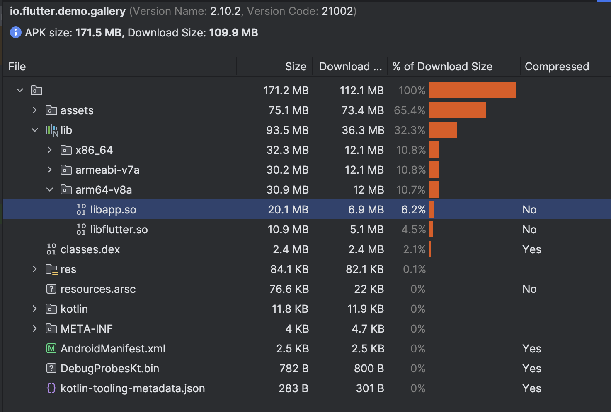

## Motivation
在add-to-app多引擎场景下，随着业务越来越多，代码越来越多，首次创建引擎十分耗时，我们的APP光libapp.so已经90+MB，在低端机首次加载大概2s，但是在add-to-app场景中，不是所有flutter页面都要一开始就加载显示，而是打开flutter页面才会展示，所以一开始就一次性加载所有代码显然不合理，那有没有办法将不需要的代码模块延迟加载呢，答案是肯定的。flutter官方支持deferred- components，但这个功能官方是为了支持google play dynamic module功能的，在我们的场景中，我们并不需要一定要远程下发，我们更需要的是代码延迟加载，而不是初始化时一次性加载。庆幸官方有考虑允许开发者自定义扩展，这篇文章就是探讨如何实现本地延迟加载代码（.so）。

## 开启Deferred-components
见https://docs.flutter.dev/perf/deferred-components，目前官方的实现只支持google play dynamic module功能，且只支持appbundle。深入代码后发现，只需要设置gradle属性deferred-components就能开启deferred components。
见
https://github.com/flutter/flutter/blob/7ff0723e08fd3f40bf866c164da8f1895ad41e71/packages/flutter_tools/gradle/src/main/kotlin/FlutterPlugin.kt#L618

实验下来确实如此

### 添加flag
- 在android/gradle.properties添加deferred-components=true
- 在pubspec.yaml添加deferred-components:

### 实现DeferredComponentManager
如何实现本地延迟加载，借鉴

```kt
class LocalDeferredImportManager(
    private val context: Context,

) : DeferredComponentManager {

    private val flutterApplicationInfo: FlutterApplicationInfo = ApplicationInfoLoader.load(context)

    private var flutterJNI: FlutterJNI? = null

    override fun setJNI(flutterJNI: FlutterJNI?) {
        this.flutterJNI = flutterJNI
    }

    override fun setDeferredComponentChannel(channel: DeferredComponentChannel?) {

    }

    override fun installDeferredComponent(
        loadingUnitId: Int,
        componentName: String?
    ) {
        Log.e("Flutter", "LocalDeferredImportManager, installDeferredComponent, loadingUnitId: $loadingUnitId, componentName: $componentName")

        loadDartLibrary(loadingUnitId, componentName);
    }

    override fun getDeferredComponentInstallState(
        loadingUnitId: Int,
        componentName: String?
    ): String? {
        return ""
    }

    override fun loadAssets(loadingUnitId: Int, componentName: String?) {

    }

    override fun loadDartLibrary(loadingUnitId: Int, componentName: String?) {
        Log.e("Flutter", "LocalDeferredImportManager, loadDartLibrary, loadingUnitId: $loadingUnitId")
        if (loadingUnitId < 0) {
            return;
        }

        val aotSharedLibraryName =
            flutterApplicationInfo.aotSharedLibraryName + "-" + loadingUnitId + ".part.so";

        // Possible values: armeabi, armeabi-v7a, arm64-v8a, x86, x86_64, mips, mips64
        val abi: String = Build.SUPPORTED_ABIS[0]!!
        val pathAbi = abi.replace("-", "_") // abis are represented with underscores in paths.

        // TODO(garyq): Optimize this apk/file discovery process to use less i/o and be more
        // performant and robust.

        // Search directly in APKs first
        val apkPaths: MutableList<String?> = ArrayList<String?>()

        // If not found in APKs, we check in extracted native libs for the lib directly.
        val soPaths: MutableList<String?> = ArrayList<String?>()

        val searchFiles: Queue<File?> = LinkedList<File?>()

        // Downloaded modules are stored here
        searchFiles.add(context.getFilesDir())

        // The initial installed apks are provided by `sourceDirs` in ApplicationInfo.
        // The jniLibs we want are in the splits not the baseDir. These
        // APKs are only searched as a fallback, as base libs generally do not need
        // to be fully path referenced.
        Log.e("Flutter", "context.applicationInfo.splitSourceDirs: ${context.applicationInfo.splitSourceDirs}")
        for (path in context.applicationInfo.splitSourceDirs ?: emptyArray()) {
            searchFiles.add(File(path))
        }

        while (!searchFiles.isEmpty()) {
            val file = searchFiles.remove()
            if (file != null && file.isDirectory() && file.listFiles() != null) {
                for (f in file.listFiles()) {
                    searchFiles.add(f)
                }
                continue
            }
            val name = file!!.getName()
            // Special case for "split_config" since android base module non-master apks are
            // initially installed with the "split_config" prefix/name.
            if (name.endsWith(".apk")
                && (name.startsWith(componentName!!) || name.startsWith("split_config"))
                && name.contains(pathAbi)
            ) {
                apkPaths.add(file.getAbsolutePath())
                continue
            }
            if (name == aotSharedLibraryName) {
                soPaths.add(file.getAbsolutePath())
            }
        }

        val searchPaths: MutableList<String?> = ArrayList<String?>()

        // Add the bare filename as the first search path. In some devices, the so
        // file can be dlopen-ed with just the file name.
        searchPaths.add(aotSharedLibraryName)

        for (path in apkPaths) {
            searchPaths.add(path + "!lib/" + abi + "/" + aotSharedLibraryName)
        }
        for (path in soPaths) {
            searchPaths.add(path)
        }

        for (s in searchPaths) {
            Log.e("Flutter", "searchPath: $s")
        }

        flutterJNI!!.loadDartDeferredLibrary(
            loadingUnitId, searchPaths.toTypedArray<String?>()
        )
    }

    override fun uninstallDeferredComponent(
        loadingUnitId: Int,
        componentName: String?
    ): Boolean {
        return true
    }

    override fun destroy() {

    }
}
```

## 效果
前



后

## 结论
这是一个可行的方案，但是它使用非标准的官方实现，需要斟酌是否符合自己项目。