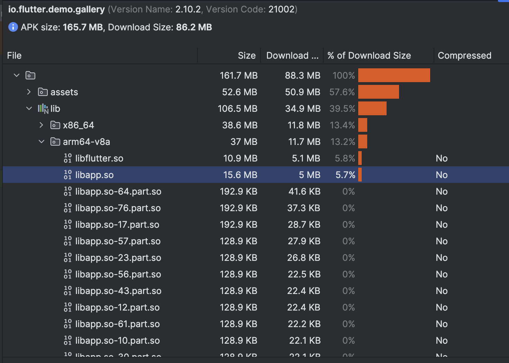

## Motivation
在 add-to-app 的多引擎场景下，随着业务变多，代码量也会持续增长，首次创建引擎的耗时会越来越明显。我们 APP 的 `libapp.so` 已经有 90+MB，在低端机上首次加载大约需要 2 秒，并且增加内存占用。

但在 add-to-app 场景里，并不是所有 Flutter 页面都会在启动时立刻展示，通常是进入某个 Flutter 页面时才真正需要加载对应代码。因此，在初始化阶段一次性加载全部代码显然不太合理。

那有没有办法把暂时不需要的代码模块延迟加载呢？答案是肯定的。Flutter 官方支持 [ Deferred-components ](https://docs.flutter.dev/perf/deferred-components)，这个能力本质上是基于 Dart 的 deferred import：构建时会把部分 Dart AOT 代码拆分成独立的 loading units（一般后缀为`part.so`），运行时再按需加载。这样就可以避免在初始化阶段一次性加载全部代码。

不过，官方这套能力默认主要是为 [Google Play Dynamic Feature Modules](https://developer.android.com/guide/playcore/feature-delivery) 设计的，并且局限了在Google Play渠道使用。对我们的场景来说，并不一定需要远程下发能力，我们更需要的是“本地代码按需加载”，而不是在初始化时一次性把所有代码都加载进来。

## 开启Deferred-components

Flutter 支持通过 Dart 的 `deferred` 关键字做延迟加载，但在 Android 上，官方默认方案是基于 [Google Play Dynamic Feature Modules](https://developer.android.com/guide/playcore/feature-delivery)，并且完整发布流程主要围绕 AAB（App Bundle）展开。

不过深入代码后可以发现，是否进入 Deferred-components 的构建流程，本质上是通过配置项控制的。只要相关配置生效，Flutter tool 就会进入 Deferred-components 的构建路径，生成 split AOT 产物。

见：  
https://github.com/flutter/flutter/blob/7ff0723e08fd3f40bf866c164da8f1895ad41e71/packages/flutter_tools/gradle/src/main/kotlin/FlutterPlugin.kt#L618

实验下来，开启这个能力的关键点主要有两个：

- 在 `android/gradle.properties` 中添加 `deferred-components=true`
- 在 `pubspec.yaml` 中添加 `deferred-components:`

配置完成后，即使构建 APK，也可以开启 Deferred-components 的相关能力。

> 以下是官方 [gallery](https://github.com/flutter/gallery/tree/main) 构建 APK 的效果  




### 实现DeferredComponentManager

如何实现“本地延迟加载”？可以参考官方 `PlayStoreDeferredComponentManager` 的实现思路，把 Google Play Core 相关逻辑去掉，仅保留本地查找和加载 `.so` 的部分。

下面是一个可行的示例：

```kt
class LocalDeferredLibraryManager(
    private val context: Context
) : DeferredComponentManager {

    private val flutterApplicationInfo: FlutterApplicationInfo = ApplicationInfoLoader.load(context)

    private var flutterJNI: FlutterJNI? = null

    override fun setJNI(flutterJNI: FlutterJNI?) {
        this.flutterJNI = flutterJNI
    }

    override fun setDeferredComponentChannel(channel: DeferredComponentChannel?) {

    }

    override fun installDeferredComponent(
        loadingUnitId: Int,
        componentName: String?
    ) {
        Log.e("Flutter", "LocalDeferredImportManager, installDeferredComponent, loadingUnitId: $loadingUnitId, componentName: $componentName")

        loadDartLibrary(loadingUnitId, componentName);
    }

    override fun getDeferredComponentInstallState(
        loadingUnitId: Int,
        componentName: String?
    ): String? {
        return ""
    }

    override fun loadAssets(loadingUnitId: Int, componentName: String?) {

    }

    override fun loadDartLibrary(loadingUnitId: Int, componentName: String?) {
        Log.e("Flutter", "LocalDeferredImportManager, loadDartLibrary, loadingUnitId: $loadingUnitId")
        if (loadingUnitId < 0) {
            return;
        }

        val aotSharedLibraryName =
            flutterApplicationInfo.aotSharedLibraryName + "-" + loadingUnitId + ".part.so";

        // Possible values: armeabi, armeabi-v7a, arm64-v8a, x86, x86_64, mips, mips64
        val abi: String = Build.SUPPORTED_ABIS[0]!!
        val pathAbi = abi.replace("-", "_") // abis are represented with underscores in paths.

        // TODO(garyq): Optimize this apk/file discovery process to use less i/o and be more
        // performant and robust.

        // Search directly in APKs first
        val apkPaths: MutableList<String?> = ArrayList<String?>()

        // If not found in APKs, we check in extracted native libs for the lib directly.
        val soPaths: MutableList<String?> = ArrayList<String?>()

        val searchFiles: Queue<File?> = LinkedList<File?>()

        // Downloaded modules are stored here
        searchFiles.add(context.getFilesDir())

        // The initial installed apks are provided by `sourceDirs` in ApplicationInfo.
        // The jniLibs we want are in the splits not the baseDir. These
        // APKs are only searched as a fallback, as base libs generally do not need
        // to be fully path referenced.
        Log.e("Flutter", "context.applicationInfo.splitSourceDirs: ${context.applicationInfo.splitSourceDirs}")
        for (path in context.applicationInfo.splitSourceDirs ?: emptyArray()) {
            searchFiles.add(File(path))
        }

        while (!searchFiles.isEmpty()) {
            val file = searchFiles.remove()
            if (file != null && file.isDirectory() && file.listFiles() != null) {
                for (f in file.listFiles()) {
                    searchFiles.add(f)
                }
                continue
            }
            val name = file!!.getName()
            // Special case for "split_config" since android base module non-master apks are
            // initially installed with the "split_config" prefix/name.
            if (name.endsWith(".apk")
                && (name.startsWith(componentName!!) || name.startsWith("split_config"))
                && name.contains(pathAbi)
            ) {
                apkPaths.add(file.getAbsolutePath())
                continue
            }
            if (name == aotSharedLibraryName) {
                soPaths.add(file.getAbsolutePath())
            }
        }

        val searchPaths: MutableList<String?> = ArrayList<String?>()

        // Add the bare filename as the first search path. In some devices, the so
        // file can be dlopen-ed with just the file name.
        searchPaths.add(aotSharedLibraryName)

        for (path in apkPaths) {
            searchPaths.add(path + "!lib/" + abi + "/" + aotSharedLibraryName)
        }
        for (path in soPaths) {
            searchPaths.add(path)
        }

        for (s in searchPaths) {
            Log.e("Flutter", "searchPath: $s")
        }

        flutterJNI!!.loadDartDeferredLibrary(
            loadingUnitId, searchPaths.toTypedArray<String?>()
        )
    }

    override fun uninstallDeferredComponent(
        loadingUnitId: Int,
        componentName: String?
    ): Boolean {
        return true
    }

    override fun destroy() {

    }
}
```

## 结论
这是一个可行方案：复用 Flutter Deferred-components 的整体机制，把 `libapp.so` 拆分成多个 `*.part.so`，并通过自定义 `DeferredComponentManager` 在本地按需加载，从而避免初始化阶段一次性加载全部代码，优化 add-to-app 多引擎场景下的首开耗时及内存占用。

不过，它本质上仍然属于“非官方标准路径”的自定义实现，是否适合落地到项目中，还需要结合自身项目的实现方式以及长期维护成本来评估。